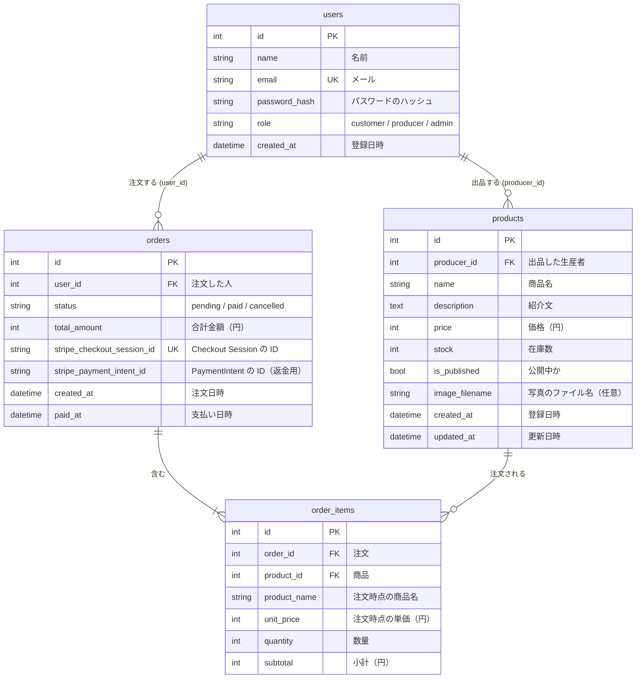

# データベース設計

[ユーザーストーリー](user-stories.md) と [画面一覧](screens.md) を実現するためのテーブル。既存の `users`（作成済み）に、`products`、`orders`、`order_items` を足す。

- 開発とテストは SQLite、本番は MySQL 8.0（utf8mb4）。文字列には長さを付け、SQLite 専用の書き方をしない
- モデルは `marche/models.py`（SQLAlchemy 2 の `Mapped` / `mapped_column`）
- カートはセッションに `{"商品ID": 数量}` で持つので、テーブルにしない

## ER 図



## カラム定義

### users（作成済み・変更なし）

| カラム | 型 | 制約 | 説明 |
|-|-|-|-|
| id | Integer | PK | |
| name | String(50) | not null | 表示名 |
| email | String(255) | not null, unique | ログイン ID |
| password_hash | String(255) | not null | `generate_password_hash` のハッシュ。平文は保存しない |
| role | String(20) | not null, default `customer` | `customer` / `producer` / `admin`（`Role` StrEnum） |
| created_at | DateTime | not null, default 日本時間の現在 | 登録日時 |

### products（商品）

| カラム | 型 | 制約 | 説明 |
|-|-|-|-|
| id | Integer | PK | |
| producer_id | Integer | not null, FK → users.id（RESTRICT）, index | 出品した生産者。所有者チェックに使う |
| name | String(50) | not null | 商品名 |
| description | Text | not null, default `""` | 紹介文（2,000 字まで。長さはフォームで確かめる） |
| price | Integer | not null, CHECK 50〜100000 | 税込み価格（円）。Stripe の最低決済額が 50 円 |
| stock | Integer | not null, default 0, CHECK 0〜999 | いまある数。支払いが確定したときに減らす |
| is_published | Boolean | not null, default False | 公開中か。新規登録は非公開から |
| image_filename | String(100) | null 可 | サーバーで付けた名前（UUID + 拡張子）。写真がなければ NULL |
| created_at | DateTime | not null, default 日本時間の現在 | |
| updated_at | DateTime | not null, default / onupdate 日本時間の現在 | |

### orders（注文）

| カラム | 型 | 制約 | 説明 |
|-|-|-|-|
| id | Integer | PK | |
| user_id | Integer | not null, FK → users.id（RESTRICT）, index | 注文した人。本人チェックに使う |
| status | String(20) | not null, default `pending`, index | `pending`（支払い待ち）/ `paid`（支払い済み）/ `cancelled`（取り消し） |
| total_amount | Integer | not null, CHECK ≥ 0 | 合計（円）。明細からサーバーで計算した値 |
| stripe_checkout_session_id | String(255) | null 可, unique | Checkout Session の ID（`cs_test_...`）。注文を作ってからセッションを作るので、最初は NULL。Webhook と完了ページで注文と照らし合わせる |
| stripe_payment_intent_id | String(255) | null 可 | PaymentIntent の ID。支払いが確定したときに保存する。返金（拡張 E2）で使う |
| created_at | DateTime | not null, default 日本時間の現在 | 注文日時。在庫を押さえる時間（35 分）の起点 |
| paid_at | DateTime | null 可 | 支払いが確定した日時 |

- 状態は `pending → paid` か `pending → cancelled` の一方向だけ
- `paid` への更新は「`status = pending` のときだけ」の条件付き更新にする。Webhook と完了ページの二重処理で、在庫が二重に減るのを防ぐ
- unique 制約では NULL どうしは重複扱いにならない（SQLite でも MySQL でも同じ）。セッション作成前の注文が複数あってもよい

### order_items（注文明細）

| カラム | 型 | 制約 | 説明 |
|-|-|-|-|
| id | Integer | PK | |
| order_id | Integer | not null, FK → orders.id（CASCADE）, index | 所属する注文 |
| product_id | Integer | not null, FK → products.id（RESTRICT）, index | 買った商品。売上の集計に使う |
| product_name | String(50) | not null | 注文時点の商品名（スナップショット） |
| unit_price | Integer | not null, CHECK 50〜100000 | 注文時点の単価（円） |
| quantity | Integer | not null, CHECK 1〜10 | 数量 |
| subtotal | Integer | not null | 小計（円）。`unit_price × quantity` を注文を作るときにサーバーで計算して保存する |

- `(order_id, product_id)` に unique 制約を付ける。1 つの注文の中で同じ商品が 2 行にならないようにする
- `orders.total_amount` は明細の `subtotal` の合計。どちらもサーバーで計算し、フォームから来た値は使わない

## 外部キーの削除時の動き

| 外部キー | 削除時 | 理由 |
|-|-|-|
| products.producer_id → users | RESTRICT | 生産者を消すと商品と売上の記録が宙に浮く。ユーザー削除はアプリの機能にない |
| orders.user_id → users | RESTRICT | 注文は支払いの記録なので、ユーザーと一緒に消してはいけない |
| order_items.order_id → orders | CASCADE | 明細は注文の一部。ORM 側も `cascade="all, delete-orphan"` にする |
| order_items.product_id → products | RESTRICT | 「注文がある商品は削除できない」。売れた商品をやめるときは非公開にする |

- `order_items.product_id` は SET NULL も考えられる（名前と単価は明細に残る）。生産者の売上集計を商品 ID でたどれるように、RESTRICT にした
- **SQLite は、標準では外部キー制約を確かめない。** 有効にする `PRAGMA foreign_keys=ON` は SQLite 専用の書き方なので使わない。開発環境では RESTRICT が効かないため、商品の削除では **注文明細があるかをアプリのコードで先に確かめて** 断る。本番の MySQL では DB 側でも止まる

## インデックス

- 外部キーの 4 つ（producer_id、user_id、order_id、product_id）
- `orders.status`: いま買える数（支払い待ちで 35 分以内の数量）の計算と、売上（支払い済み）の集計で使う
- `users.email` と `orders.stripe_checkout_session_id`: unique 制約で自動的にインデックスが作られる

## 在庫の方式

### 2 つの方式の比較

| 方式 | `stock` の意味 | 利点 | 欠点 |
|-|-|-|-|
| A. 毎回計算 | これまでに入荷した総数。いま買える数 = 総数 − 支払い済み − 支払い待ち | 在庫を減らす処理が要らず、二重に減る心配がない | 生産者が「いま 10 個ある」ではなく「入荷の総数」を入れる必要がある。補充のたびに計算が要る |
| **B. 支払い確定時に減らす（採用）** | いまある数。支払いが確定したときに減らす | 生産者の感覚と同じ。収穫したら「いまの数」に書き換えるだけ | 確定の処理が二重に走ると二重に減る |

### B を選んだ理由

- 産直品は毎日収穫して在庫を足すので、生産者が「いまの数」をそのまま入れられる方式がよい
- B の欠点（二重に減る）は、条件付き更新で防ぐ。Webhook と完了ページのどちらで確定しても、`status = pending` の注文だけを `paid` にし、更新できた（1 行変わった）ときだけ `stock` を減らす

### `stock` が変わるとき

| できごと | `stock` |
|-|-|
| 生産者が商品を登録・編集する | 入力した数にする |
| 注文を作る（支払い待ち） | **変えない**（いま買える数の計算で押さえる） |
| 支払いが確定する（Webhook か完了ページ） | 明細の数量だけ減らす。足りなければ 0 で止める |
| 注文を取り消す | **変えない**（支払い待ちが消えるので、押さえが自然に戻る） |

## いま買える数の計算

```text
いま買える数 = products.stock − （支払い待ちで、作成から 35 分以内の注文の、その商品の数量の合計）
```

- 0 より小さくなったら 0 にする
- 一覧・詳細の表示（売り切れの判定、数量の選択肢 1〜min(10, いま買える数)）と、注文を作るときの在庫の確認で使う
- 計算は `marche/services/inventory.py` の `available_stock(product)` に置く。views はこの関数を呼ぶ

SQLAlchemy の書き方（SQLite でも MySQL でも動く）:

```python
from datetime import timedelta

from sqlalchemy import func, select

HOLD_MINUTES = 35


def available_stock(product: Product) -> int:
    since = now_jst() - timedelta(minutes=HOLD_MINUTES)
    reserved = db.session.scalar(
        select(func.coalesce(func.sum(OrderItem.quantity), 0))
        .join(Order)
        .where(
            OrderItem.product_id == product.id,
            Order.status == OrderStatus.PENDING,
            Order.created_at >= since,
        )
    )
    return max(product.stock - reserved, 0)
```

- 期限の時刻は Python で計算して渡す。SQL の日付関数（SQLite の `datetime()` や MySQL の `NOW()`）は使わない

### 支払い待ちを引く理由と、35 分にした理由

- 支払い待ちを引かないと、A さんが Stripe の画面でカード番号を入れている間に、B さんが最後の 1 個を買えてしまう
- Stripe の Checkout Session の有効期限は最短 30 分。時計のずれを見込んでセッションの期限を 31 分にし、在庫の押さえはそれより少し長い 35 分にする
- 期限が切れた決済ページでは支払えないので、35 分を過ぎた支払い待ちは数えなくてよい。決済ページを閉じたまま放置した人の分が、在庫を押さえ続けることもない
- 中断ページで注文を取り消せば、35 分を待たずに押さえが戻る

### この方式で残る問題

- 2 人が同時に最後の 1 個を注文すると、両方の注文が通ることがある（確認と作成の間に隙間がある）。支払い確定時に `stock` が足りなければ 0 で止めるが、片方は「売れたのに在庫がない」状態になる。対策（行ロック、条件付きの減算、在庫不足なら返金）は拡張 E1
- 一覧では商品ごとに集計の SQL が走る（8 商品なら 8 回）。1 回にまとめるのは拡張 E16
