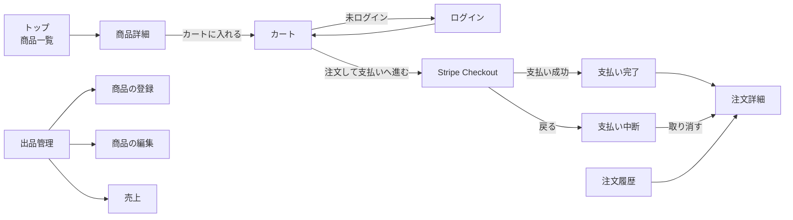

# 画面一覧

[ユーザーストーリー](user-stories.md) を実現するための画面と URL。URL は [仕様書 2](../spec/02_screens.md) に合わせる。

## 画面: Day4

| 画面名 | URL | ログインが必要か | 使えるロール | 表示するもの・できること |
|-|-|:-:|-|-|
| トップ（商品一覧） | `/` | 不要 | 誰でも | 公開中の商品の写真、商品名、価格、生産者名、在庫（0 なら「売り切れ」） |
| 商品詳細 | `/products/<id>` | 不要 | 誰でも（非公開の商品は出品者と管理者のみ。他の人には 404） | 写真、価格、紹介文、生産者名、在庫。数量を選んで「カートに入れる」 |
| 会員登録 | `/register` | 不要 | 未ログイン | 名前、メール、パスワード、「購入者 / 生産者」の選択 |
| ログイン | `/login` | 不要 | 未ログイン | メール、パスワード |
| カート | `/cart/` | 不要 | 誰でも | 商品、単価、数量（変更でき、0 なら外す）、小計、合計。「注文して支払いへ進む」 |
| 出品管理 | `/producer/products` | 必要 | 生産者 | 自分の商品の一覧（公開状態、在庫）。公開の切り替え、削除、「商品を登録する」 |
| 商品の登録 | `/producer/products/new` | 必要 | 生産者 | 商品名、価格、在庫数、紹介文、写真、公開するか |
| 商品の編集 | `/producer/products/<id>/edit` | 必要 | 生産者（所有者のみ。他人の商品は 403） | 登録と同じ項目 |
| 注文詳細 | `/orders/<id>` | 必要 | 注文した本人、管理者（他人は 403） | 注文の状態、明細、合計 |

## 画面: 平日

| 画面名 | URL | ログインが必要か | 使えるロール | 表示するもの・できること |
|-|-|:-:|-|-|
| 支払い完了 | `/orders/<id>/complete` | 必要 | 注文した本人、管理者 | Stripe から戻る画面。確定前は「確認中」と出し、自動で再読み込みする |
| 支払い中断 | `/orders/<id>/cancel` | 必要 | 注文した本人、管理者 | Stripe で「戻る」を押したときの画面。「この注文を取り消す」 |
| 注文履歴 | `/orders/` | 必要 | ログインユーザー全員 | 自分の注文を新しい順に表示。注文日時、合計、状態 |
| 売上 | `/producer/sales` | 必要 | 生産者 | 自分の商品ごとの販売数と売上（支払い済みだけ）、合計 |
| （Stripe Checkout） | Stripe のサイト | ─ | ─ | カード情報を入力する。アプリの外の画面 |

## POST だけの URL（画面ではない操作）

値を変える操作は全て POST にする。GET のリンクだと、リンクを踏ませるだけで削除などができてしまうため。

| 操作 | URL | ログインが必要か | 使えるロール | 内容 | 時期 |
|-|-|:-:|-|-|:-:|
| ログアウト | `POST /logout` | 必要 | ログインユーザー | ログアウトしてトップへ | Day4（実装済み） |
| カートに入れる | `POST /cart/add/<id>` | 不要 | 誰でも | 数量を指定してセッションのカートに入れる | Day4 |
| 数量を変える | `POST /cart/update/<id>` | 不要 | 誰でも | 数量を変える（0 なら外す） | Day4 |
| 注文を作る | `POST /orders/` | 必要 | ログインユーザー | 在庫を確認し、金額を DB で計算して支払い待ちの注文を作る（平日に Stripe へのリダイレクトを足す） | Day4 |
| 公開の切り替え | `POST /producer/products/<id>/toggle` | 必要 | 生産者（所有者） | 公開と非公開を入れ替える | Day4 |
| 商品の削除 | `POST /producer/products/<id>/delete` | 必要 | 生産者（所有者） | 削除する（注文がある商品は削除できない） | Day4 |
| 注文の取り消し | `POST /orders/<id>/cancel` | 必要 | 注文した本人、管理者 | 支払い中断画面から注文を取り消し、押さえていた在庫を戻す | 平日 |
| Stripe Webhook | `POST /stripe/webhook` | ─ | Stripe | 支払いの確定と在庫の減算。CSRF の対象外にし、署名で確かめる | 平日 |

## ナビゲーション

| ロール | ヘッダーのメニュー |
|-|-|
| 未ログイン | 商品一覧（ロゴ）、カート、ログイン、会員登録 |
| 購入者 | 商品一覧、カート、注文履歴、ログアウト |
| 生産者 | 商品一覧、カート、注文履歴、出品管理、売上、ログアウト |
| 管理者 | 購入者と同じ（管理画面は拡張 E15） |

- 注文履歴と売上は平日課題で作る。Day4 の時点ではメニューに出さない

## 画面遷移

- Day4 の時点では Stripe がないので、「注文して支払いへ進む」のあとは注文詳細（支払い待ち）へ移る

## 各画面の要点

### トップ・商品詳細

- 公開中（`is_published = true`）の商品だけを出す
- 非公開の商品の詳細は、出品した生産者と管理者だけが見られる。それ以外の人には 404（「ある」ことも教えない）
- 在庫は「いま買える数」（[データベース設計](database.md) の計算）を出す。0 なら「売り切れ」と出し、カートに入れるボタンを出さない
- 数量の選択肢は 1〜min(10, いま買える数)

### カート

- カートはセッションに `{"商品ID": 数量}` で持つ。ログインしていなくても使える
- 小計と合計は表示のために計算するだけ。注文を作るときは、サーバーが DB の価格で計算し直す
- 非公開になった商品と、なくなった商品は、カートの表示から外す
- 注文を作るときに、いま買える数を超えていたら注文を作らず、カートに戻してメッセージを出す

### 出品管理・商品の登録・商品の編集

- 出品管理には自分の商品だけを出す
- 入力の上限: 商品名 50 字、紹介文 2,000 字、価格 50〜100,000 円、在庫数 0〜999
- 写真は JPEG / PNG / WebP、5MB まで。拡張子と中身（先頭のバイト）の両方を確かめる。保存するファイル名はランダム（UUID + 拡張子）にし、元のファイル名は使わない
- 新しく登録した商品は、「公開する」に印を付けなければ非公開
- 注文がある商品は削除できない。「非公開にしてください」と出す

### 注文詳細

- 注文番号（`orders.id`）、注文日時、状態（支払い待ち / 支払い済み / 取り消し）、明細（商品名、単価、数量、小計）、合計
- 明細は、注文時点の商品名と単価（`order_items` に保存した値）で出す

### 支払い完了（平日）

- URL の `session_id` が注文に保存した `stripe_checkout_session_id` と一致し、注文が支払い待ちなら、Stripe に問い合わせて `payment_status = paid` なら支払い済みにする
- Webhook が先に届いていれば、注文はすでに支払い済み
- 支払い待ちのままなら「確認中」と出し、5 秒ごとに再読み込みする（`<meta http-equiv="refresh" content="5">`）

### 支払い中断（平日）

- 「この注文を取り消す」で、Stripe の Checkout Session を期限切れにしてから、注文を取り消し（`cancelled`）にする。押さえていた在庫が戻る
- すでに支払いが済んでいて期限切れにできないときは、取り消さずに注文詳細へ移る

### 注文履歴・売上（平日）

- 注文履歴は自分の注文だけを、新しい順に出す
- 売上は自分の商品ごとの販売数と売上の合計。支払い済み（`paid`）の注文だけを数える

## 認可のルール

認可はビューの中で確かめる。

| 対象 | 操作 | 許可 | 違反したとき | 書く場所 |
|-|-|-|-|-|
| 生産者の画面（`/producer/`） | 全て | ロールが producer | 未ログインはログインへ、他のロールは 403 | `@role_required(Role.PRODUCER)` |
| 商品 | 編集・削除・公開の切り替え | 出品した生産者（`producer_id` が自分） | 403 | `get_own_product_or_403()` |
| 商品 | 閲覧（非公開） | 出品した生産者、管理者 | 404 | `can_view()` |
| 商品 | 閲覧（公開中） | 誰でも | ─ | ─ |
| 注文 | 作成 | ログインユーザー | ログインへ | `@login_required` |
| 注文 | 閲覧・完了・中断・取り消し | 注文した本人、管理者 | 403 | `get_own_order_or_403()` |
| 管理者 | 作成 | 画面からは不可。`flask create-admin` だけ | 登録で `admin` を送ると 422 | `RegisterForm` の選択肢 |

- ボタンを隠すだけでは守れない。URL を直接開いたり、POST を直接送ったりしても弾かれることを、テストで確かめる
- 「ロールの確認」（URL 単位）と「所有者の確認」（データ 1 件単位）は別物。生産者でも、他の生産者の商品は編集できない

## 補足

- 管理者のストーリー「全ての注文を確認したい」: コアでは、管理者は注文詳細（`/orders/<id>`）を見られるだけ。全注文の一覧画面（`/admin/orders` など）は拡張 E15 の範囲
- 支払い中断の `/orders/<id>/cancel` は、GET で画面を表示し、POST で注文を取り消す
